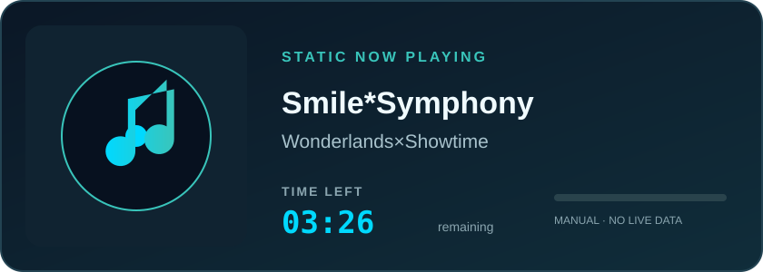

<div align="center">


### `request → logic → data → response`

**Hai, aku Len!** Aku tertarik pada dunia backend—tempat logika, server, dan data bekerja bersama agar sebuah aplikasi benar-benar hidup.

[](https://github.com/LenRenCode)
[](https://github.com/LenRenCode)

</div>

---

## `whoami`

```text
╭────────────────────────────────────────────────────────╮
│ USER       : LenRenCode                                │
│ ROLE       : Mahasiswa · Backend & Database Enthusiast │
│ ENVIRONMENT: Arch Linux                                 │
│ INTERESTS  : Server · Node.js · JavaScript · Data      │
│ STATUS     : Learning, building, and improving         │
╰────────────────────────────────────────────────────────╯
```

Aku suka memahami apa yang terjadi **di balik layar**: bagaimana server menerima request, menjalankan logika, membaca atau menyimpan data, lalu mengirim response yang tepat.

## Mengapa backend dan server?

Server adalah pusat yang menghubungkan banyak bagian aplikasi. Dari merancang alur request sampai memastikan data tersusun dengan baik, backend memberi ruang untuk memecahkan masalah lewat logika dan desain sistem.

- **Node.js** menarik karena JavaScript bisa digunakan untuk membangun sisi server, dengan ekosistem yang luas untuk membuat layanan dan API.
- **JavaScript** terasa seru karena satu bahasa bisa menjembatani pengalaman di browser dan proses di backend.
- **Database** membuatku penasaran pada cara data dimodelkan, di-query, dijaga konsistensinya, dan disajikan kembali dengan efisien.
- **Server** adalah tempat semuanya bertemu: aplikasi, logika, dan data bekerja sebagai satu sistem.

## Alur yang ingin terus kupelajari

```text
CLIENT
  │
  │ HTTP request
  ▼
SERVER · Node.js
  │
  ├── routing & application logic
  │
  ├── validation and error handling
  │
  ▼
DATABASE
  │
  │ query / result
  ▼
SERVER ── HTTP response ──► CLIENT
```

Fokus belajarku adalah memahami tiap lapisan—bukan hanya membuat endpoint berjalan, tapi juga memikirkan struktur data, alur yang jelas, dan bagaimana aplikasi bisa dikembangkan dengan lebih baik.

## Teknologi & area eksplorasi

<p>
  
  
  
  
  
</p>

> Stack dan minat yang sedang dieksplorasi—selalu bertumbuh seiring proses belajar dan proyek.

## 🎧 Favorite music

Musik yang menemani waktu santai maupun sesi ngulik:

<div align="center">



</div>

> Kartu ini statis dan tidak memakai koneksi realtime. Untuk mengganti lagu atau waktunya, edit teks judul lagu, artis, dan `TIME LEFT` di [`assets/music-card.svg`](./assets/music-card.svg). Angka `03:26` adalah durasi lagu dari gambar; tampilan waktu tidak berkurang otomatis.

- 🎤 **Vocaloid** — lagu-lagu Vocaloid jadi salah satu favorit untuk didengarkan.
- 🎶 **Smile*Symphony** — salah satu yang sering masuk playlist.

## Current learning loop

```js
const len = {
  focus: ["backend", "server", "database"],
  exploring: ["Node.js", "JavaScript", "API design"],
  mindset: "understand the system, then make it better",
  status: "always learning",
};

console.log("Server-side journey: online ⚡");
```

## GitHub activity

<div align="center">


</div>

## Connect

Punya ide project backend, API, atau database? Mari ngobrol dan belajar bareng lewat [GitHub-ku](https://github.com/LenRenCode).

<div align="center">

### `Keep the server curious. Keep the data meaningful.` ✨


</div>
